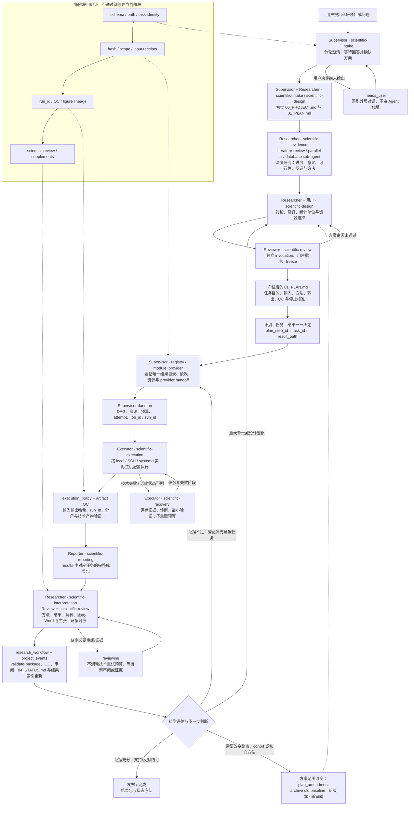
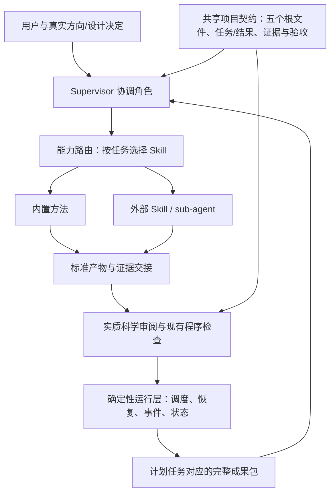

# 可替换方法、固定项目契约的科研架构

[查看 v0.8.0 总体架构 PNG](../results/architecture_assessment/figures/scientific_architecture_v0.8.0.png)

[查看 v0.7.0 历史模块结构 PNG](../results/architecture_assessment/figures/scientific_architecture_v0.7.0.png)

[查看 Agent 运行工作流 PNG](../results/architecture_assessment/figures/scientific_agents_runtime_workflow_v0.8.0.png)

[查看详细可执行工作流 PNG](../results/architecture_assessment/figures/scientific_agents_workflow_detailed_v0.8.0.png)

[查看原始 flowchart 风格的科研主工作流 PNG](../results/architecture_assessment/figures/scientific_research_workflow_v0.8.0.png)

[查看清晰版主工作流 PNG](../results/architecture_assessment/figures/scientific_research_workflow_clean_v0.8.0.png)

[查看 v0.8.1 横向清晰版主工作流 PNG（推荐）](../results/architecture_assessment/figures/scientific_research_workflow_v0.8.1.png)

[View the v0.8.1 English workflow PNG](../results/architecture_assessment/figures/scientific_research_workflow_v0.8.1_en.png)

这张运行图只描述一次已批准科研任务的协作过程：Supervisor 负责方向和交接，Researcher 负责证据与设计，Executor 负责授权任务和技术恢复，Reviewer 负责科学验收，Reporter 负责完整成果包。它不表示每个任务都必须同时启动五个 Agent；阶段按任务需要调用，确定性程序保留调度、预算、哈希、事件和状态写入权。图中的 `needs_user`、`repairable` 和 `reviewing` 是有意保留的停留点，不是可被 Agent 自动绕过的失败状态。

## 原始 flowchart 风格的主流程

下面的 Mermaid 与 PNG 保持同一条主线。它保留你原图中的“问题 → 计划 → 结果 → 下一步科学判断”结构，同时把每个阶段负责的 Agent、Skill/provider 和自验证环节标出来。

这里的核心身份链是 `01_PLAN.md` 的 `plan_step_id → task_id → result_path → results/<task>/`。一个计划步骤只能绑定一个规范结果目录；同一任务的多次技术 attempt 和定向恢复仍保留在这个任务目录及其运行记录中，不会产生脱离计划的第二套结果树。

本项目的目标是验证一个具体科研项目中的明确问题，不追求无限发散的新观点。每一个结果或结论都必须给出支持证据、反对证据或明确标记为不确定；证据不足时登记有限的补充证据任务，不能凭空生成新的科学结论。技术故障可以按既有恢复协议诊断和重试，但科学范围、终点和核心方法的变化必须经过用户/Reviewer 的定向修订与批准。

本次重构以当前实现的完整特性为基线，用户举出的五个根文件、详细规划、计划—结果对应和完整成果包只是其中一部分。现有特性的归属和验证方式见 [FEATURE_PRESERVATION.md](FEATURE_PRESERVATION.md)。本轮没有改变研究模板、设计冻结、报告渲染、结果验收、事件、调度、恢复额度或执行驱动的实现。

## 架构

共享契约规定研究如何组织、什么才算完成；Skill 提供可复用方法；Agent 角色规定谁处理什么任务以及如何交接；平台适配负责用宿主真实能力调用；运行层保留状态和调度权。它们不是一一对应。

### 发表级科研图

正式结果图由 `scientific-visualization` 负责，概念图、机制图和流程图可使用 `scientific-schematics`。我们采用的公开 Skill 来源包括 [scientific-visualization](https://github.com/K-Dense-AI/scientific-agent-skills/tree/main/skills/scientific-visualization) 和 [scientific-schematics](https://github.com/K-Dense-AI/scientific-agent-skills/tree/main/skills/scientific-schematics)。前者要求图形回溯到源表、运行和输入，使用适合期刊的尺寸、字体、单位、不确定性、色盲友好配色和矢量/高分辨率导出；后者适合结构和概念表达，不能替代数据图的数值证据。具体门槛见 [figure_quality_contract.md](../skills/scientific-research-project/references/figure_quality_contract.md)。

绘图不达标时只启动有限的视觉修正循环：渲染 → 独立检查 → 记录缺陷 → 修改绘图脚本/版式 → 重新渲染 → 再验收。这个循环可以修正字号、间距、图例、颜色、面板和导出格式，但不能改数据、分母、统计结论或研究范围；连续失败则返回 `revise` 或 `needs_user`，不能用视觉“变漂亮”代替科学证据。

`scientific-research-project` 保持兼容入口和自包含核心包。独立阶段入口是 scientific-intake、scientific-evidence、scientific-design、scientific-execution、scientific-recovery、scientific-interpretation、scientific-reporting、scientific-review。阶段 Skill 依赖核心契约，核心本身不依赖额外安装这些入口：只安装核心时仍可按路由读取内置 references。

Supervisor、Researcher、Executor、Reviewer、Reporter 的平台中立职责位于核心 references/roles/。角色按需调用，不要求每次启动五个 Agent，不自动创建团队，也不把同一 Agent 的多遍审阅称为独立审查。Claude 的薄适配文件引用这些契约；Codex 可用阶段 Skill 和角色契约。实际运行能力仍取决于宿主工具、权限和配置。

## 如何换成一个更好的深度研究模块

1. 检查新 Skill/sub-agent 的真实入口、版本、工具、访问范围和产物。只采用其检索、证据提取、综合方法；不能带入另一套总计划、根目录或自动团队规则。
2. 在目标科研项目的 `registry/providers.json` 中把 `evidence` 绑定到它，声明 `kind: skill` 或 `subagent`、版本、适用 host 和产物转换说明。完整示例见[provider_contract.md](../skills/scientific-research-project/references/provider_contract.md)。其他能力继续沿用默认方法。
3. 运行核心的 `module_provider.py resolve` 检查路由；用 `prepare` 创建绑定当前根文件、任务和 provider 的交接请求。外层 Codex/Claude 用真实可用的 Skill/sub-agent 调用方式执行。
4. 保存原始输出和证据，将其整理成已有的 appraisal.json、可读调研综合、证据矩阵、方法比较及限制说明。外部输出缺少核心证据时应补齐或标为不完整，不能制造证据。
5. `check-output` 核验交接身份、版本、路径、哈希及适用的结构；之后仍做实质审阅和原有方案讨论/冻结。程序通过不代表论文支持论点，也不等于用户已批准方案。

外部 provider 不可用或与宿主不兼容时会明确报错，不静默替换方法。没有 providers.json 的项目使用内置方法。工具不安装或下载第三方代码；选择 provider 也不授予额外付费、上传、科学设计修改或任务执行权限。

新产物保存在原任务 results 路径下面的 `_evidence/providers/`；尚未形成正式任务的调研保存在 provenance/providers/，再与现有调研/修订记录关联。不会多出第六个根指导文件或第二套正式结果目录。

## 代码和兼容边界

- `assets/modules.json`：能力、角色、必读规范和输出要求。
- `scripts/module_provider.py`：只读路由、唯一交接请求、输出结构/证据核验；不提交作业、不写完成状态、不改五个根文件。
- `scripts/progress_worker.py`：现有 Codex 后台适配器按任务选 execution/recovery，保存 provider 记录；请求期间配置/契约变化会保留原始输出并拒绝直接交付。原契约提案格式和 daemon 接口保持不变。
- `references/worker_contract.md`：从旧 Python 提示词移出的执行规则，保持原恢复、授权、隔离和真实验证要求。
- 现有 `research_workflow.py`、`project_events.py`、`supervisor_daemon.py`、执行/恢复策略与驱动：继续承担原检查与运行责任，本轮没有替换它们。

不同平台共用方法/产物契约，不代表任何第三方 Agent 都能无需适配即插即用。当前通用研究交接由外层宿主调用；常驻 worker 仍内置 Codex CLI。Claude Agent 定义和通用 JSON 交接已提供，但本轮没有在线验证 Claude 或外部文献 Agent。没有增加 Slurm、云、容器或任意 API 执行驱动。

能力替换仍需检查方法、输入和权限兼容，并在有必要时编写产物转换说明/适配代码。只改“供应商名称”不能自动补齐科学质量和证据。代码验证也不是对任意外部代码的沙箱隔离。

## 安装和迁移

现有核心包安装命令仍有效。要启用独立 Skill 发现，在检查目标副本独立修改后复制本仓库 `skills/scientific-*` 全部目录到宿主的 skills 目录，并在 Claude 下复制 `adapters/claude/scientific-*.md`。README 中给出成套命令。

本轮仅修改源仓库，没有更新用户已安装副本，没有重启后台服务，没有迁移任何实际科研项目。根文件、任务/运行/作业编号、原始证据和冻结记录继续保留。现有项目无需为了模块化重跑；新的 provider 交接从下一次明确的能力调用开始，不追溯改变旧成果归属。

验收包含原有科研工作流回归与新增 provider 测试。离线测试能验证结构、状态和边界，不能验证真实文献深度、对话质量、第三方性能或在线平台兼容；这些需用真实授权任务另行验证。

## v0.8.0 补强

模块数量和根文件不变。新增强制的版本绑定审阅门槛、Codex 只读审阅入口、受控方案修订事务、必要/可选补证据节点和行为评价工具。旧版图表达模块归属，不表示所有平台已完成实测。具体实现和兼容边界见[本次修订记录](../results/architecture_assessment/20260922_revision_v0.8.0.md)及[科研治理协议](../skills/scientific-research-project/references/scientific_governance.md)。
